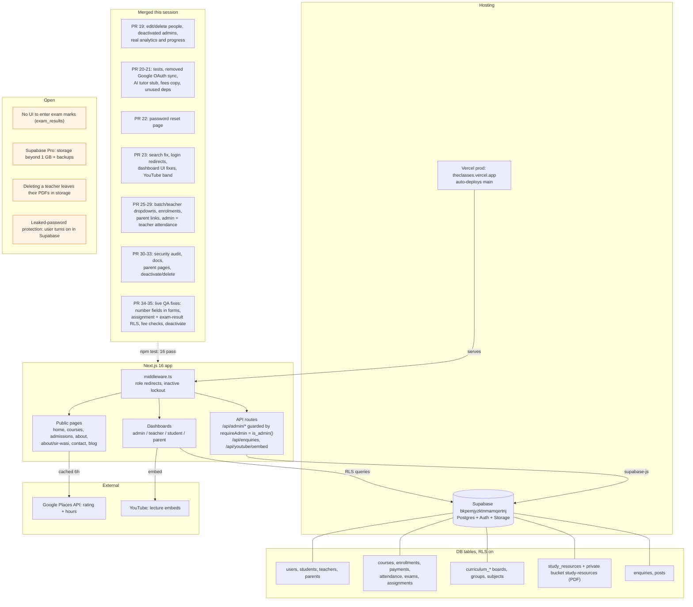

# The Classes: project context graph

Short map of the system and of the work done so far. Read this first in a new
session instead of replaying the old conversation. GitHub renders the graph below.

## Facts that are easy to get wrong

- Default branch is `main`; every merge deploys to production.
- Migrations: write the file, apply with Supabase `apply_migration`, then rename
  the file to the version Supabase recorded.
- `npm test` runs PGlite database tests (all migrations applied in order) and unit tests.
- Admin-created users set `provisioned_by: "admin"` in user metadata so the sign-up
  trigger skips them.
- Deleting a login cascades to users, role rows and parent links.
- `users` UPDATE is column-granted (name, phone, avatar, last login only), even for admins;
  changing `is_active` or `role` needs the service client.
- Enrollments default to `pending`; readers filter on `active`, so admin enrolments set `active`.
- Number inputs in react-hook-form need `valueAsNumber: true`, or zod rejects them as strings.
